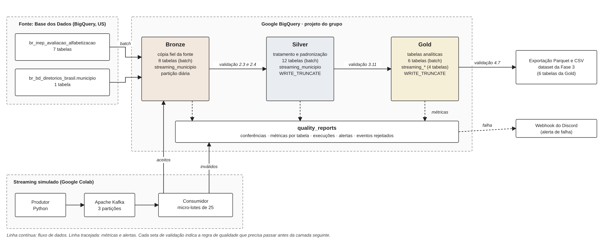

# Tech Challenge — Fase 2 · Pipeline Híbrido para Análise da Alfabetização no Brasil

**FIAP · Pós-Tech AI Scientist · Grupo Nexus AI**

| Integrante | RM |
|---|---|
| Cauê Kepler | RM376037 |
| Gabriel Patelli | RM376324 |
| Lucas El Jaick Bentes Silva | RM376599 |
| Hugo Manuel Alves Tajima | RM376035 |

## Entregáveis

| Entregável | Onde está |
|---|---|
| Notebook com o pipeline completo, executado, com as saídas | [`notebooks/NexusAI_techfase2.ipynb`](notebooks/NexusAI_techfase2.ipynb) |
| Vídeo de apresentação | 🎥 ⟨link do vídeo⟩ |
| Código separado por camada · mapa do notebook | [`src/`](src/) · [`docs/mapa_do_notebook.md`](docs/mapa_do_notebook.md) |
| Arquitetura | [`docs/arquitetura.png`](docs/arquitetura.png) (vetorial: `docs/arquitetura.svg`) |
| Evidências de execução (16 prints + preços do BigQuery) | [`evidencias/`](evidencias/) |
| Dataset da Gold para a Fase 3 (Parquet e CSV das 6 tabelas, execução `20261024_070829`) | [`dados_gold/gold_export.zip`](dados_gold/gold_export.zip) |
| Apêndices · guia de execução | [`docs/apendices.md`](docs/apendices.md) · [`docs/guia_de_execucao.md`](docs/guia_de_execucao.md) |

## Resumo

Reunimos as tabelas do Indicador Criança Alfabetizada em um pipeline no **Google BigQuery**, em três camadas (**Bronze**, **Silver** e **Gold**). Os dados chegam em **lote** (tabelas históricas) e em **tempo quase real** (eventos simulados com Apache Kafka). Cada camada é conferida antes de a seguinte ser criada: se uma regra importante falha, a execução para e um alerta chega ao Discord.

| O que | Resultado |
|---|---|
| Tabelas criadas | 26 no lote (8 Bronze, 12 Silver, 6 Gold), mais 6 do streaming (1 Bronze, 1 Silver, 4 Gold) |
| Regras de qualidade | 88 no lote (8 Bronze, 61 Silver, 19 Gold) e 34 no streaming (6 Bronze, 13 Silver, 15 Gold) |
| Conferência pelos microdados | Taxa recalculada do Brasil em 2024: **59,20%**, igual à oficial |
| Streaming | 216 eventos: 188 aceitos, 16 repetidos, 12 inválidos |
| Custo | Cerca de **US$ 0,22 por mês** com uma execução mensal (zero dentro da cota gratuita) |

**Por onde começar:** para rodar, a [seção 12](#12-como-executar) (cerca de 10 minutos, sem cartão). Para as provas, a [seção 14](#14-evidências-de-execução).

## 1. O problema

O **Compromisso Nacional Criança Alfabetizada** quer que toda criança saiba ler e escrever até o fim do 2º ano. O INEP mede isso com o **Indicador Criança Alfabetizada**: a porcentagem de alunos avaliados que atingem ou superam a nota de corte de **743 pontos**. Os dados vêm em tabelas separadas (resultados, metas, território e notas de cada aluno). Este projeto junta tudo, confere a qualidade e deixa os dados prontos para análise e para o modelo da Fase 3.

**Sobre a meta de 2030.** As tabelas oficiais trazem uma meta por ano, de 2024 a 2030, que chega a **80%** em 2030 na rede Pública. Todas as distâncias até a meta usam essa meta publicada. A projeção até 2030 é um cenário, não uma previsão.

## 2. Arquitetura



Seguimos a **Arquitetura Medalhão**:

| Camada | O que guarda | Como é gravada |
|---|---|---|
| **Bronze** | Cópia fiel das 8 tabelas de origem (7 do dataset oficial + diretório de municípios) e `streaming_municipio` (streaming) | **Uma cópia por dia**: rodar de novo no mesmo dia troca a cópia daquele dia, e os outros dias ficam ([política](#111-política-de-histórico-da-bronze)). O streaming só acrescenta |
| **Silver** | 12 tabelas limpas e padronizadas, mais `streaming_municipio` | Refeita a cada execução, a partir da cópia mais recente da Bronze |
| **Gold** | 6 tabelas analíticas, mais 4 de streaming (`streaming_*`, seção 6). A coluna `origem` (`oficial` ou `simulado`) existe em todas | Refeita a cada execução |
| **quality_reports** | Conferências, métricas, execuções, alertas e eventos rejeitados | Acumula todas as execuções |

Detalhes de gravação: [Apêndice A](docs/apendices.md#apêndice-a-como-cada-camada-é-gravada).

| Tabela da Gold | Pergunta que responde | Linhas |
|---|---|---|
| `indicador_municipio` | Como está a alfabetização em cada cidade? | 23.995 |
| `meta_vs_resultado` | O lugar atingiu a meta do ano? | 11.030 |
| `evolucao_temporal` | Melhorou ou piorou? Quanto falta para 2030? | 43.228 |
| `validacao_taxa` | A taxa recalculada pelos microdados bate com a oficial? | 24.143 |
| `desigualdade_regional` | Como as cidades se distribuem por região e estado? | 62 |
| `base_modelagem` | Dados prontos para treinar o modelo da Fase 3 | 5.500 |

As seis entidades do enunciado são usadas: `uf` e as três tabelas de meta entram em `meta_vs_resultado` e `evolucao_temporal`; `municipio` entra em todas as tabelas municipais; `alunos` entra em `indicador_municipio` e `validacao_taxa`. Atenção: nem todas as colunas de distância usam o mesmo sinal ([Apêndice F](docs/apendices.md#apêndice-f-detalhes-da-gold-e-da-modelagem)).

| Ferramenta | Para que serve | Por que |
|---|---|---|
| Google BigQuery (Sandbox) | Guardar e processar as três camadas | Os dados de origem já estão lá; o Sandbox é gratuito |
| Google Colab | Rodar o notebook | Gratuito e sem instalação |
| Python 3 ([`requirements.txt`](requirements.txt)) | Fluxo, regras de qualidade e exportação da Gold | Linguagem do curso |
| Apache Kafka 3.7.0 (`kafka-python-ng`) | Simular a chegada de eventos | Sobe dentro do Colab, sem servidor externo |
| Discord (webhook) | Avisar quando o pipeline falha | Aviso imediato, sem infraestrutura extra |

Tudo o que aparece aqui foi implementado e executado. O que não foi feito está na [seção 11](#11-limitações).

## 3. Roteiro do notebook

Ordem das etapas: **Configuração** (você cola o ID do projeto; é a única célula que edita) → **1 Ambiente** → **2 Bronze** → **3 Silver** → **4 Gold** (inclui exportação Parquet/CSV e 5 gráficos dos resultados, na 4.9) → **5 Diário e custos** → **6 Streaming** → **7 Falha de propósito**. A execução termina em erro na Etapa 7, de propósito: é a demonstração de que a validação para o pipeline. O mapa completo, com etapa, camada e arquivo de `src/`, está em [`docs/mapa_do_notebook.md`](docs/mapa_do_notebook.md).

## 4. Decisões

**Fonte: BigQuery, não download.** O dataset já está no BigQuery e é mais novo que o arquivo de download: `meta_alfabetizacao_uf` tinha 54 linhas no arquivo e 81 no BigQuery (que inclui 2025). **Custo:** a cópia lê cerca de 260 MB por execução. Fonte e projeto ficam na mesma região (US), então não há transferência entre regiões ou nuvens nem custo de saída.

**Quando a fonte for atualizada.** A execução do dia grava uma nova cópia na Bronze, e a Silver passa a usar a mais recente. As cópias anteriores continuam consultáveis, e a Etapa 2.3 compara a contagem de linhas de cada tabela com a fonte.

**Data warehouse, não data lake.** Com cerca de 4 milhões de linhas em formato de tabela, tudo cabe no BigQuery. A Bronze por dia faz o papel de camada bruta, e a Gold é exportada em Parquet para a Fase 3.

**Lote e streaming.** Lote para as tabelas históricas, que mudam uma vez por ano. Streaming para novas medições, com gravação gratuita (alguns segundos por lote). Há formas mais rápidas (cerca de 1 s), mas são cobradas.

**Ausente nunca vira zero.** Roraima, sem metas em 2023 e 2024, aparece nesses anos como "sem meta" e não como meta zero. A taxa usa só alunos avaliados, com o **peso amostral**. Regras completas: [Apêndice B](docs/apendices.md#apêndice-b-regras-de-negócio).

## 5. Qualidade dos dados

Cada camada passa por uma conferência antes de a próxima ser criada. Regra **bloqueante** reprovada interrompe o pipeline (exemplo: taxa fora de 0 a 100). Regra **informativa** só avisa (exemplo: meta de 2030 diferente de 80). O resultado de cada regra é gravado em `quality_reports.conferencias` **antes** da decisão, então uma reprovação também fica registrada.

| Conferência | Etapa | Regras | Se uma bloqueante falhar |
|---|---|---|---|
| Bronze | 2.3 e 2.4 | 8 | A Silver não é criada |
| Silver | 3.11 | 61 (45 bloqueantes, 16 informativas) | A Gold não é criada |
| Gold | 4.7 | 19 (18 bloqueantes, 1 informativa) | A exportação não acontece |
| Streaming | 6.3.1 a 6.3.3 | 34 (6 Bronze, 13 Silver, 15 Gold; 31 bloqueantes, 3 informativas) | A execução para |

**Execução de referência `20261024_070829`: todas as regras aprovadas no lote (88 de 88) e 34 de 34 no streaming** (6 testes das funções de qualidade e 5 da validação de eventos também passaram).

**Cruzamento entre tabelas.** Quando uma linha não acha par, o BigQuery devolve vazio, sem erro. Por isso medimos quantas linhas acharam par e reprovamos abaixo de um limite definido a partir do valor medido: UF → meta, 100% (limite 100%); município → meta, 97,78% (limite 95%); alunos → resultado, 99,89% (limite 99%). Os motivos das diferenças estão no [Apêndice B](docs/apendices.md#apêndice-b-regras-de-negócio).

**Falha de propósito (Etapa 7).** Uma tabela de teste recebe 3 defeitos (taxa 150, rede sem tradução, linha duplicada). A validação interrompe a célula, a falha é gravada e o alerta `[TESTE]` chega ao Discord. Os dados reais não são alterados.

**Conferência pelos microdados.** Recalculamos a taxa a partir das notas dos alunos, com peso amostral. No Brasil em 2024 dá **59,20%**, igual ao oficial, com 1.851.828 alunos avaliados (sem o peso daria 59,78%). Nas cidades, 99,03% das linhas ficam a até 0,5 ponto da taxa oficial.

## 6. Streaming

O streaming **simula novas medições de 2025** para 200 municípios, a partir da taxa de 2024 com variação aleatória. Das 216 mensagens, 16 são reenvios e 12 têm defeito de propósito: **188 aceitas, 16 repetidas e 12 inválidas**, em 9 micro-lotes de até 25 eventos.

| | Lote (batch) | Streaming |
|---|---|---|
| Como o dado chega | Tabela inteira, de uma vez | Evento por evento, em micro-lotes |
| Frequência | A cada execução do notebook | Contínua, enquanto houver eventos |
| Espera pelo dado | Até a próxima execução (mensal, no uso previsto) | Mediana de 23,6 s; 95% em até 53,5 s; máximo de 54,8 s |
| Garantia | Cópia completa, conferida com a fonte | *Pelo menos uma vez*: o evento só é confirmado depois de gravado (evita perda, permite repetição); repetições são descartadas pelo `evento_id` |
| Dado inválido | A validação para o pipeline | O evento é separado com o motivo e o resto segue |

**O caminho do streaming é o mesmo do lote.** Cada evento tem o formato de uma linha de `bronze.municipio` e percorre três camadas, com verificações em cada uma:

| Camada | Tabela de streaming | Verificações |
|---|---|---|
| Bronze | `bronze.streaming_municipio` (só acréscimo) | 6 regras: `evento_id` único, `origem`, horários, latência e contagem (recebidas = aceitas + repetidas + inválidas) |
| Silver | `silver.streaming_municipio` (mesma receita de `silver.resultado_municipio`) | 13 regras: chave, código sem tradução, série, taxa de 0 a 100, nome, ano, tipos das chaves e território |
| Gold | 4 tabelas (`streaming_indicador_municipio`, `streaming_meta_vs_resultado`, `streaming_evolucao_temporal` e `streaming_desigualdade_regional`), uma para cada resposta da Gold que o resultado do município alimenta | 15 regras, incluindo a correspondência com a meta e a conferência de que nada simulado entrou nas seis oficiais |

`validacao_taxa` e `base_modelagem` não têm versão de streaming: a primeira precisa de notas de alunos, inexistentes em 2025, e a segunda usa só 2023 e 2024. As validações rodam por camada, antes de a seguinte ser criada, e uma regra bloqueante reprovada interrompe a execução. As tabelas oficiais do lote são só lidas, nunca gravadas, e só elas vão para a Fase 3. **Os números da Gold de streaming não são análise**: as medições são inventadas, e a Gold existe para levar o evento até a camada analítica final.

A espera é medida com dois horários: o produtor grava o envio (`criado_em`) e o consumidor, a chegada (`recebido_em`).

## 7. Monitoramento

| O enunciado pede | Como está feito |
|---|---|
| Falhas de ingestão | Um vigia de erros registra toda falha, com etapa e mensagem, em `quality_reports.execucoes` |
| Latência | Streaming: chegada menos envio, por evento. Lote: duração de cada consulta |
| Volume processado | Linhas de entrada e saída, MB lidos, duração e `job_id` por tabela, em `quality_reports.metricas_por_tabela` |
| Alertas de erro | Mensagem no Discord e registro em `quality_reports.alertas` |

As métricas **se acumulam**: cada execução acrescenta linhas, sem apagar as anteriores. A execução de referência gravou 26 tabelas e 8.000.551 linhas (soma das tabelas das três camadas, não alunos únicos), com 43,3 s de soma das durações dos jobs de gravação (não a duração total do notebook). As tabelas de streaming também gravam as suas métricas aí. Nas saídas, as colunas rotuladas `MB` ou `mb_lidos` usam divisão por 1.024² bytes, ou seja, MiB.

**Quem descobre que o pipeline quebrou, e em quanto tempo?** O canal do Discord do grupo, no mesmo instante da falha: o vigia de erros envia o alerta de forma síncrona (`requests.post`, com tempo limite de 10 s), na mesma execução e antes de gravar a falha em `quality_reports.execucoes`, com a etapa e a mensagem do erro. Em segundos, portanto, enquanto alguém estiver rodando o notebook. Como a execução é manual, numa execução não assistida ninguém recebe o alerta na hora: a falha fica gravada no diário e no canal até alguém abrir um dos dois (limitação registrada na [seção 11](#11-limitações)).

## 8. Custos (FinOps)

- **Armazenamento:** Bronze por dia; Gold exportada em Parquet, 6,9 vezes menor que o CSV (2.352,9 KiB contra 16.245,7 KiB; 1 KiB = 1.024 bytes).
- **Consultas:** só as colunas necessárias, uma partição da Bronze por vez, então o custo por execução não cresce com o histórico.
- **Controle:** simulação de custo antes de cada gravação, teto de 5 GiB por consulta, Kafka só durante a sessão e gravação por *carga* (gratuita).

**Consumo medido (execução `20261024_070829`):** as gravações leram 826,43 MB; as consultas faturaram **3,993 GiB** (147 consultas e 6 cargas), quase tudo na tabela `alunos` ([Apêndice C](docs/apendices.md#apêndice-c-consumo-da-execução-de-referência)). O faturado é maior que o lido nas gravações porque inclui as consultas de conferência e de medição, que releem tabelas já gravadas, e porque o BigQuery fatura no mínimo 10 MB por consulta, mesmo nas pequenas (147 consultas nesta execução). O armazenamento medido ao fim da execução foi de 0,746 GiB para uma cópia da Bronze e 0,774 GiB para Silver, Gold e `quality_reports`; a tabela abaixo projeta esse valor para 12 meses. O streaming fica fora desse total (a Etapa 5.2 roda antes da 6): a Silver e a Gold de streaming leram cerca de 3,5 MB, e os eventos entram por carga gratuita, o que não muda a projeção.

O trabalho roda no BigQuery Sandbox, gratuito. A tabela abaixo (Etapa 5.2) mostra o custo do mesmo desenho em produção, com uma execução por mês e as quantidades medidas. Preços de cloud.google.com/bigquery/pricing para a região **US (várias regiões)**, a mesma dos datasets, consultados em 22/10/2026.

| Serviço | Unidade | Quantidade medida | Preço unitário | Custo mensal |
|---|---|---|---|---|
| BigQuery · consultas | TiB processado | 3,993 GiB por execução | US$ 6,25 | US$ 0,0244 |
| BigQuery · armazenamento | GiB-mês | 9,72 GiB após 12 meses (12 cópias de 0,746 GiB + 0,774 GiB de Silver, Gold e controle) | US$ 0,020 | US$ 0,1945 |
| BigQuery · carga | GiB carregado | 6 cargas no lote + 1 por lote no streaming | gratuito | US$ 0,00 |
| **Total (uma execução por mês)** | | | | **US$ 0,2189** (US$ 0,00 com a cota gratuita) |

| Frequência | Custo mensal | Com a cota gratuita |
|---|---|---|
| Mensal (pretendida) | US$ 0,2189 | US$ 0,0000 |
| Semanal | US$ 0,8289 | US$ 0,5314 |
| Diária | US$ 6,1163 | US$ 5,1851 |

O que cresce com a frequência é o armazenamento (cada dia guarda uma cópia da Bronze de cerca de 0,75 GiB); o custo de consulta é o mesmo por execução. A projeção considera o armazenamento acumulado ao fim de 12 meses, todo ao preço ativo; não representa a retenção de 59 dias do Sandbox nem a média do custo ao longo do primeiro ano.

## 9. Uso na Fase 3 (IA)

`gold.base_modelagem` tem 5.500 municípios (rede Municipal) e foi preparada para o modelo:

- **entradas:** taxa de 2023, proficiência média e alunos avaliados de 2023, e as metas de 2024 e 2030;
- **alvos:** colunas com prefixo `alvo_` (taxa de 2024, variação e se atingiu a meta).

**Vazamento de alvo.** As regras bloqueantes garantem que toda coluna tem um papel declarado e que só os alvos levam o prefixo `alvo_`. Além disso, conferimos que as metas de entrada já constavam da publicação de 2023, anterior ao resultado de 2024: nas 5.352 cidades presentes nas duas publicações, nenhuma meta diferiu. Isso ajuda, mas não garante: antes de treinar, é preciso selecionar as entradas e validar a disponibilidade temporal de cada uma ([Apêndice F](docs/apendices.md#apêndice-f-detalhes-da-gold-e-da-modelagem)).

**Cuidados:** (1) as 627 cidades de São Paulo não têm notas de alunos em 2023, então as variáveis de alunos ficam vazias de forma não aleatória; (2) cidades pequenas oscilam muito de um ano para o outro, e parte do alvo é ruído de amostra; (3) 5.396 municípios têm taxa de 2023 e alvo de 2024. A correlação entre as duas taxas é 0,635: o ano anterior explica parte do resultado, o que justifica um modelo com mais variáveis.

**Usos possíveis:** prever municípios em risco de não atingir a meta, analisar a desigualdade regional e priorizar apoio técnico com dados conferidos. Em 2024, 91,3% das cidades do Ceará atingiram a meta, contra 9,5% das do Rio Grande do Sul; esse percentual mede o cumprimento da meta de cada cidade, não o nível de alfabetização.

## 10. Investigações (anomalias na fonte)

1. **`meta_alfabetizacao_uf`:** o arquivo de download tinha 54 linhas e o BigQuery tem 81. Usamos o BigQuery como fonte única.
2. **Três municípios em 2023** (Guaramiranga/CE, Groaíras/CE, Pontes e Lacerda/MT) têm taxas diferentes nas duas tabelas oficiais. O recálculo com os alunos reproduz a tabela de meta (Groaíras: 99,15 no resultado, 83,1 na meta, 83,11 recalculado); nessas linhas, a taxa da rede Municipal no resultado é igual à da rede Pública, o que sugere erro de preenchimento na fonte (não confirmado). A Gold usa o valor confirmado em todas as tabelas e registra isso em `fonte_da_taxa`; em `indicador_municipio`, a taxa publicada no resultado fica também em `taxa_original_resultado`. A exceção vale só para nível município, ano 2023 e rede Municipal; qualquer outra divergência (outro ano, outra rede, outra cidade) bloqueia a execução, e a regra é testada com linhas de exemplo.
3. **4.199 alunos (0,11%)** pertencem a recortes sem resultado publicado, quase sempre com poucos avaliados.
4. **242 cidades-ano** têm resultado e não têm meta; **50** cidades têm meta e não têm resultado em 2023.
5. **São Paulo não tem notas de alunos em 2023** (627 municípios), por isso a taxa recalculada do Brasil em 2023 (57,46) difere da oficial (55,90). Em 2024 as duas coincidem.
6. **A trajetória nacional de 2025 vem arredondada** (60, 64, 67, 71, 74, 77, 80). Para cada ano usamos a meta publicada no próprio ano.

## 11. Limitações

Versão resumida; os detalhes estão no [Apêndice G](docs/apendices.md#apêndice-g-limitações-em-detalhe).

- **Streaming simulado.** O Kafka roda dentro do Colab e some ao fechar a sessão; os eventos de 2025 são inventados a partir de 2024. Só a Bronze é incremental: a Silver e a Gold de streaming são refeitas a cada execução, e a latência é medida até a chegada ao consumidor, antes de o micro-lote ser gravado.
- **Histórico da Bronze é por dia, não por execução** (seção 11.1); o "dia" segue o horário UTC.
- **Execução manual.** Sem agendamento, nova tentativa automática ou alerta de custo; o alerta do Discord só existe enquanto alguém roda o notebook.
- **Sem orquestração, infraestrutura como código nem integração contínua.** As etapas rodam em sequência dentro do notebook, e os datasets são criados por ele com as permissões da conta autenticada no Colab. Em produção, as etapas seriam encadeadas com dependência, nova tentativa e agendamento (Cloud Composer/Airflow ou Cloud Scheduler), o ambiente seria recriado por Terraform e os testes da Etapa 1.3 rodariam a cada alteração do código. Nada disso foi implementado neste trabalho.
- **Lacunas da fonte.** Estados sem resultado da rede Pública (AC, DF e RR em 2023; DF e RR em 2024), `nivel_alfabetizacao` sem tradução, dicionário sem as tabelas de meta, e o Brasil em 2025 (66,0) sem microdados para conferir.
- **Taxas de correspondência só exibidas.** A Etapa 3.9.3 mede cinco cruzamentos, mas a validação da Silver grava e decide três (UF → meta, município → meta e alunos → resultado). Os outros dois, `meta_uf → resultado_uf` (90,74%; 5 de 54 sem par) e `meta_municipio → resultado_municipio` (99,53%; 50 de 10.704 sem par), aparecem só na saída da célula e estão explicados na Investigação 4, mas não ficam em `quality_reports`.
- **Conferência pelos microdados.** 100 linhas de município (0,4%) diferem em mais de 1 ponto, sem causa apurada; o limiar de 98% (medido: 99,03%) tem folga sobre o medido.
- **Gold e qualidade.** A desigualdade regional não pondera por alunos, a validação não impõe um número mínimo de regras e a conferência de taxa entre `indicador_municipio` e `meta_vs_resultado` só compara pares com as duas taxas preenchidas.
- **Robustez do streaming.** A validação de eventos não cobre todos os formatos (taxa ou ano em texto e JSON malformado podem gerar erro em vez de rejeição), e uma falha do produtor não é propagada à execução principal. Nada disso afetou a execução demonstrada.
- **Testes.** Cobrem as funções de qualidade e a validação de eventos; o SQL é conferido pelas regras a cada execução.

### 11.1 Política de histórico da Bronze

O enunciado pede que uma execução não apague a anterior. Conferimos como o nosso modo de gravação (`WRITE_TRUNCATE` na partição do dia) realmente se comporta:

| Situação | O que acontece |
|---|---|
| Rodar em **dias diferentes** | Cada dia guarda a sua cópia; uma execução não apaga a de outro dia |
| Nova execução **no mesmo dia** | A nova cópia **substitui** a anterior; fica só a última |
| Conferências, métricas, diário e alertas (`quality_reports`) | **Sempre acumulam** |

Se o notebook rodar 3 vezes no mesmo dia, só a cópia da última fica na Bronze, e as 3 execuções ficam em `quality_reports`. Escolhemos assim para manter uma única cópia por partição, evitar duplicação de dados na leitura da Silver e respeitar o limite de 10 GiB do Sandbox (cerca de 0,75 GiB por cópia), com uso previsto mensal e sem necessidade de preservar várias execuções no mesmo dia. No Sandbox, as partições expiram em 59 dias. A cópia permanente da Gold é o Parquet da Etapa 4.8. Em ambiente pago, a Bronze poderia só acrescentar cópias com retenção (proposta não implementada: [Apêndice E](docs/apendices.md#apêndice-e-guardar-todas-as-execuções-em-um-ambiente-pago-proposta)).

## 12. Como executar

Preparo: cerca de 10 minutos, sem cartão. **Você precisa de:** uma conta Google, um projeto no Google Cloud com o BigQuery em modo Sandbox e o Google Colab.

1. **Crie um projeto** em [console.cloud.google.com/projectcreate](https://console.cloud.google.com/projectcreate) e copie o **ID** (não o nome).
2. **Abra o BigQuery** em [console.cloud.google.com/bigquery](https://console.cloud.google.com/bigquery). Se aparecer a oferta de teste gratuito, ignore: o Sandbox funciona sem cartão.
3. **Abra o notebook no Colab:** **Arquivo → Fazer upload de notebook**, e envie `notebooks/NexusAI_techfase2.ipynb`.
4. **Cole o ID na célula Configuração** (a primeira célula de código): troque o valor de `ID_DO_PROJETO`.
5. **Opcional:** configure o alerta no Discord pelo [guia de execução](docs/guia_de_execucao.md#alerta-no-discord-opcional). Sem ele, o pipeline roda do mesmo jeito.
6. **Execute tudo:** **Ambiente de execução → Reiniciar sessão e executar tudo.** Aceite os dois avisos de permissão: acesso à sua conta Google (Etapa 1) e ao Secret `ALERTA_WEBHOOK_URL` (Etapa 1.2).

**O que esperar:** a **Etapa 6.0 (Kafka)** baixa 114 MB e pode levar **até 10 minutos** (aguarde "Kafka pronto"). A execução **termina em erro na Etapa 7, de propósito**. Se o ID estiver errado, a Etapa 1 para com "Não consegui usar o projeto". Se alguma célula do BigQuery der `503 ServiceUnavailable`, é uma indisponibilidade momentânea: espere alguns minutos e use **Reiniciar sessão e executar tudo**. Campos vazios na Gold são de propósito: significam "não se aplica" ou "a fonte não informou", nunca zero.

Permissões, o aviso `[sandbox]` e a tabela de problemas comuns estão no [guia de execução](docs/guia_de_execucao.md). Nenhuma senha ou chave está no repositório: o login é o do Colab, e a URL do webhook fica só nos Secrets.

## 13. Estrutura do repositório

```
├── README.md · LICENSE · requirements.txt
├── notebooks/NexusAI_techfase2.ipynb   # pipeline completo, executado, com saídas
├── src/                                # o mesmo código, um arquivo por camada (00 a 90)
├── docs/                               # arquitetura, mapa do notebook, guia de execução, apêndices
├── evidencias/                         # 16 prints da execução + 14_precos_bigquery_us.pdf
├── graficos/                           # 5 gráficos dos resultados da Gold (Etapa 4.9)
└── dados_gold/gold_export.zip          # as 6 tabelas da Gold (Parquet e CSV) para a Fase 3
```

Os arquivos de `src/` são o mesmo código do notebook, separado por camada para facilitar a leitura. Para executar, use o notebook, porque as células compartilham variáveis.

## 14. Evidências de execução

**Execução de referência:** `20261024_070829` (24/10/2026, 07:08 UTC = 04:08 em Brasília), projeto `fresh-lens-512607-c2` (novo, sem execuções anteriores), uma partição na Bronze (`20261024`); streaming `20261024_071710`. Os `job_id` estão nas saídas do notebook e em `quality_reports.metricas_por_tabela`. Os prints não têm URL de webhook, senhas ou e-mails.

| Arquivo | O que mostra | Critério |
|---|---|---|
| [`01_console_datasets.png`](evidencias/01_console_datasets.png) | Os quatro datasets no console do BigQuery | Cloud |
| [`02_bronze_particionada.png`](evidencias/02_bronze_particionada.png) | `bronze.alunos` particionada por `_ingestion_date`: 1 partição, 3.867.999 linhas | Medalhão / FinOps |
| [`03_historico_bronze.png`](evidencias/03_historico_bronze.png) | A partição diária da execução de referência: `20261024`, 3.867.999 linhas (Etapa 5.3) | Medalhão |
| [`04_validacao_silver.png`](evidencias/04_validacao_silver.png) | As 61 regras da Silver, todas aprovadas: 45 bloqueantes e 16 informativas (Etapa 3.11) | Qualidade |
| [`05_falha_proposital.png`](evidencias/05_falha_proposital.png) | A execução terminando em `ErroDeQualidade` (Etapa 7) | Qualidade |
| [`06_alerta_discord.png`](evidencias/06_alerta_discord.png) | A mensagem `[TESTE]` recebida no canal | Monitoramento |
| [`07_diario_execucoes.png`](evidencias/07_diario_execucoes.png) | Resumo da execução e histórico em `quality_reports.execucoes` (Etapa 5.1) | Monitoramento |
| [`08_metricas_por_tabela.png`](evidencias/08_metricas_por_tabela.png) | Linhas, MB lidos e duração por tabela (Etapa 5.1) | Monitoramento |
| [`09_streaming_lotes.png`](evidencias/09_streaming_lotes.png) | Os 9 lotes do streaming (Etapa 6.2) | Ingestão híbrida |
| [`10_latencia.png`](evidencias/10_latencia.png) | Latência medida e quadro lote × streaming (Etapa 6.4) | Ingestão híbrida / Monitoramento |
| [`11_custos.png`](evidencias/11_custos.png) | Consumo medido e tabela de custos (Etapa 5.2) | FinOps |
| [`12_validacao_cruzada.png`](evidencias/12_validacao_cruzada.png) | Brasil 2024: recalculada igual à oficial, 59,20 (Etapa 4.4) | Diferencial |
| [`13_job_history.png`](evidencias/13_job_history.png) | Jobs do BigQuery depois da execução; os 3 com erro são checagens de primeira execução, tratadas pelo código ([Apêndice D](docs/apendices.md#apêndice-d-notas-sobre-os-prints)) | Cloud |
| [`14_precos_bigquery_us.pdf`](evidencias/14_precos_bigquery_us.pdf) | Preços do BigQuery, região US, em 22/10/2026 (US$ 6,25/TiB; US$ 0,000027397/GiB-hora) | FinOps |
| [`15_validacao_gold.png`](evidencias/15_validacao_gold.png) | As 19 regras da Gold, com a consistência da taxa entre tabelas e o teste da exceção das 3 cidades (Etapa 4.7) | Qualidade |
| [`16_exportacao_gold.png`](evidencias/16_exportacao_gold.png) | As 6 tabelas da Gold exportadas, com manifesto e tamanhos em Parquet e CSV (Etapa 4.8) | Cloud / Fase 3 |
| [`17_validacao_streaming.png`](evidencias/17_validacao_streaming.png) | Validação do pipeline de streaming: Bronze (6.3.1), Silver (6.3.2) e Gold (6.3.3), 34 regras ao todo, e a conferência de que o simulado não entrou nas tabelas oficiais | Ingestão híbrida / Qualidade |

Notas sobre os prints 03, 04, 07, 08, 13 e 17: [Apêndice D](docs/apendices.md#apêndice-d-notas-sobre-os-prints).

## 15. Uso de IA

Um assistente de IA apoiou a escrita de partes do código e da documentação; as decisões, a execução e a validação dos resultados foram do grupo.

## 16. Referências

- Base dos Dados. Datasets `br_inep_avaliacao_alfabetizacao` e `br_bd_diretorios_brasil`. basedosdados.org.
- INEP. Pesquisa Alfabetiza Brasil (2023) e Compromisso Nacional Criança Alfabetizada.
- Google Cloud. Preços do BigQuery, região US (cloud.google.com/bigquery/pricing, consultado em 22/10/2026).
- Apache Kafka 3.7.0 (archive.apache.org/dist/kafka).
- Material do curso (POSTECH): ETL Pipelines, NoSQL para ciência de dados, Bancos de dados relacionais e Arquitetura de Big Data (Fase 2).
